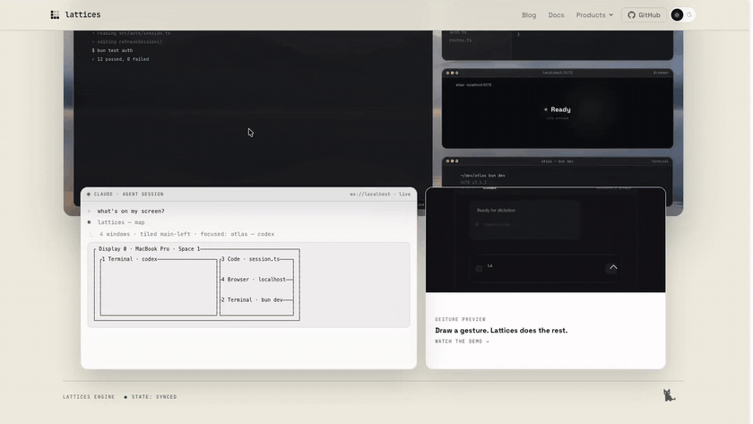

<p align="center">
  
</p>

<h1 align="center">lattices</h1>

<p align="center">
  <strong>macOS developer workspace manager.</strong><br />
  Tile windows, keep tmux sessions, search the screen, and drive the desktop from a local daemon.
</p>

<p align="center">
  <a href="https://www.npmjs.com/package/@arach/lattices"></a>
  <a href="LICENSE"></a>
  <a href="https://github.com/arach/lattices/releases/latest"></a>
  <a href="https://www.npmjs.com/package/@arach/lattices"></a>
</p>

<p align="center">
  <a href="https://lattices.dev">lattices.dev</a>
  · <a href="https://lattices.dev/family">what it can do</a>
  · <a href="https://lattices.dev/docs/overview">docs</a>
  · <a href="https://github.com/arach/lattices/releases/latest">releases</a>
  · <a href="https://lattices.dev/docs/api">agent API</a>
</p>

<p align="center">
  
</p>

Native Swift menu bar app (`apps/mac`) plus a TypeScript CLI (`bin/lattices.ts`). The app hosts a localhost WebSocket daemon. Agents, scripts, and the CLI use the same surface. A Linux machine can run `packages/host-linux` and speak that protocol, so a Mac can list, place, and visit its windows.

```
■ □ □     tile      search     spaces
■ □ □     sessions  daemon     OCR
■ ■ ■     layers    voice      agents
```

<table>
<tr>
<td><strong>Tile</strong><br>Halves, quarters, thirds, and <code>CxR</code> grids from hotkeys, CLI, or the palette.</td>
<td><strong>Search</strong><br>Titles, apps, session tags, terminal cwd, and indexed OCR.</td>
<td><strong>Spaces</strong><br>Ctrl+← / Ctrl+→ switches Spaces as an instant cut.</td>
</tr>
<tr>
<td><strong>Sessions</strong><br><code>.lattices.json</code> panes, optional tmux, ensure/prefill on reattach.</td>
<td><strong>Daemon</strong><br><code>ws://127.0.0.1:9399</code>, localhost only, no auth.</td>
<td><strong>OCR</strong><br>Vision + FTS5. Quick scan every 60s, deep scan every 2h.</td>
</tr>
<tr>
<td><strong>Layers</strong><br>Cmd+Option+1–9 aims a layer. Release switches. Slot 5 shows the current one.</td>
<td><strong>Voice</strong><br>Ctrl+Option+Space opens the command bar. Hold Option while it is key to speak (Vox, in-process on <code>:9398</code>).</td>
<td><strong>Agents</strong><br>CLI, <code>daemonCall</code>, and installable skills.</td>
</tr>
</table>

Without tmux you still get the app, tiling, layers, OCR, search, and the daemon. tmux adds persistent sessions.

## Install

The menu bar app is macOS 26+. The published package is `@arach/lattices` (`@lattices/cli` is an old name, stuck at 0.11.1). The `lats` and `lattices` binaries are one command, and the launcher runs it with [Bun](https://bun.sh). The docs use `lats`.

The npm package is `darwin` only. Linux does not install the menu bar app. A Hyprland machine runs the host in [`packages/host-linux`](packages/host-linux), below.

```sh
npm install -g @arach/lattices
lats app                # build or download the menu bar companion
```

From a checkout:

```sh
git clone https://github.com/arach/lattices
cd lattices && bun link
lats app
```

One-shot installer (Homebrew, tmux, Bun, CLI, menu bar app). The script itself rejects macOS older than 13. The app requires 26.

```sh
curl -fsSL https://raw.githubusercontent.com/arach/lattices/main/install.sh | bash
```

`lats app install` registers a user LaunchAgent so the companion starts at login.

Grant **Accessibility** and **Screen Recording** under System Settings → Privacy & Security. Instant Space switching, window targeting, OCR, and mouse gestures need them.

### Linux host

`packages/host-linux` exposes a Hyprland desktop to other Lattices machines over Tailscale. It uses the Mac daemon envelope (`{id, method, params}`) on port 9399, bound to this machine's tailnet IPv4 address and to `127.0.0.1`. Loopback is trusted. Every other client pairs once. The companion bridge listens on the same addresses, port 5287.

Needs Bun, a Hyprland session, and Tailscale. The visiting cursor also needs Quickshell for the overlay and `wtype` for keystrokes.

```sh
bun install --cwd packages/host-linux --ignore-scripts --omit optional
bun packages/host-linux/src/main.ts          # or: bun packages/host-linux/src/main.ts --describe
```

`packages/host-linux/systemd/` has user units. The tray installer fills in this checkout and the current Bun, links the units, and enables the tray. The host stays off at login until you enable it.

```sh
bun packages/host-linux/scripts/install-tray.ts
systemctl --user enable --now lattices-host   # when you want the host at login
```

From a Mac that already has `lats`:

```sh
lats hosts add archie archie
lats --host archie pair                        # approve the code on archie
lats --host archie call host.describe
lats --host archie call windows.place '{"app":"firefox","placement":"left"}'
```

Pairing defaults to scope `act`. `--read-only` and `--drive` ask for less or more, and a wider scope needs a new approval. `clients.approve` and `clients.deny` are accepted only on the host's loopback. `lats hosts` lists `~/.lattices/hosts.json` and `LATTICES_HOSTS`. `lats hosts --discover` probes your own online tailnet devices for port 9399.

Bring the host pointer home without a visit:

```sh
lats --host archie call mouse.home
```

More of the protocol, the tray, and capability probes: [`packages/host-linux/README.md`](packages/host-linux/README.md).

## First session

```sh
cd ~/your-project
lats init               # writes .lattices.json
lats app                # menu bar app and daemon
lats start              # create or attach (tmux); alias: lats tmux
```

Bare `lats` is a status screen. It does not attach.

```json
{
  "ensure": true,
  "panes": [
    { "name": "shell", "size": 60 },
    { "name": "server", "cmd": "bun dev" }
  ]
}
```

No config: if `package.json` has `dev`, `start`, `serve`, or `watch`, two panes (shell on the left, that script on the right). Package manager follows `bun.lock` / `bun.lockb`, then `pnpm-lock.yaml`, `yarn.lock`, then npm. Otherwise one shell pane.

```sh
lats search api --deep
lats place frontend left
lats tile right
lats map
```

`--deep` and `--all` both search the index and live terminal tabs (cwd, titles, tmux, running commands).

## Machines

Workspace → Machines lists this Mac, visit pairings, and Lattices hosts (`hosts` is still a page name). The canvas draws local displays to scale and each paired machine from the displays `host.describe` reported, or one generic 1920×1080 screen when a host has none. Drag a machine against a display. The stretch of edge it touches is where the pointer crosses, so two machines can share a side. A drag of a local display is a draft. **Apply** starts a 15-second trial. **Keep** accepts it (`lats visit arrangement keep`). **Revert** restores the previous origins (`lats visit arrangement revert`). Opening the page does not arm a visit.

A visit lends this Mac's mouse and keyboard to a paired machine. The Mac pointer parks. The host draws a coral visitor labelled with this machine's name, and keys type there. The host's own pointer stays put until a click, scroll, or drag. Arm edge crossing, then push past the edge:

```sh
lats visit pair archie              # bridge defaults to archie:5287; approve on archie
lats visit side archie left         # or: lats visit place archie 3440 0
lats visit on
lats visit archie                   # enter now, at the middle of the touching span
```

`lats visit pair` can also take `host:port` and then a side (`left`, `right`, `top`, `bottom`). The default side is `right`. A visit ends when the visitor leaves by the edge it entered, the channel drops, or either side hears nothing for 6 seconds. Control+Option+Command+Home and `lats visit end` end it and leave the Mac pointer where it was parked. `lats home` and `lats mouse home` end it and move the pointer to the center of the main display (menu bar: Bring Cursor Home).

`lats visit off` disarms crossing. `lats visit status` prints pairings. `lats visit forget archie` drops one.

A display marked elsewhere stays off this Mac's pointer. Pushing toward it visits the machine assigned to it.

```sh
lats visit screens
lats elsewhere 2 archie             # number or a case-insensitive name fragment
lats here 2
```

The menu bar app can receive visits. That stays off until you enable it. The Machines switch is "Let other machines visit this Mac".

```sh
lats visit host on
lats visit host off
```

`lats machines` merges this machine, `~/.lattices/hosts.json`, and visit pairings: reachable or not, OS, version, commit, display count, pairing, placement. `--json` too.

```sh
lats bring dell                     # every other display's windows onto this one
lats bring --undo
lats main dell                      # 15-second trial
lats main dell --keep
lats @archie windows                # daemon command on a configured host; @local is here
lats @archie call windows.list
```

`lats @<host>` only runs commands that call the daemon. Anything else is local-only. The Mac daemon still binds `127.0.0.1:9399` only, so `@host` reaches a machine that is actually listening at the address in `~/.lattices/hosts.json` or `LATTICES_HOSTS`. The Linux host does. Visit pairing is separate from that file. Add machine in the app can write a host, start a visit pairing, or both.

[`docs/visit.md`](docs/visit.md).

## Keyboard

Hyper is Control+Option+Shift+Command. Caps Lock hold → Hyper, tap → Escape (on by default; Settings → General → Keyboard remaps).

| Shortcut | Action |
| --- | --- |
| **Ctrl+← / Ctrl+→** | Instant Space switch (Mission Control slide hotkeys stay off while this is on) |
| **Ctrl+Option+arrows** | Tile the frontmost window to a half. With the aim HUD already up, arrows set the aim and releasing Ctrl+Option applies. Two arrows aim a corner |
| **Ctrl+Option+1–9** | Tile to that cell of the 3×3 matrix (number row or numpad) |
| **Ctrl+Option+Shift+1 / 2 / 3** | Tile thirds |
| **Ctrl+Option+G** | 4×4 grid placement |
| **Ctrl+Option+V** | Fill an open 3×2 cell |
| **Ctrl+Option+mouse** | Aim HUD; release to tile, stay centered to cancel |
| **Ctrl+Option+Space** | Command bar |
| **Cmd+Option+1–9** | Aim the layer in that slot. Release Cmd+Option to switch. 5 shows the current layer. Numpad digits hit the same slots |
| **Hyper+L** | Overview |
| **Hyper+1** | Workspace home |
| **Hyper+G** | In-place window tools |
| **Ctrl+Cmd+M** | Hands-off mode |

Voice Command is a rebindable shortcut with no default binding. Hold Option while the command bar is key to speak. Middle-drag up sends Hyper+D, which fires only after that shortcut is bound.

Inside a tmux session: prefix is Ctrl+B. `d` detach, arrows move panes, `z` zoom, `[` scroll.

Only bare Ctrl+arrows are claimed for Spaces. Ctrl+Option+arrows still tile.

## Mouse

Hold a button, draw, release. Defaults live in `~/.lattices/mouse-shortcuts.json` (Settings → Shortcuts → Mouse Gestures).

| Gesture | Default |
| --- | --- |
| Middle-drag **left** / **right** | Previous / next Space |
| Middle-drag **down** | Screen map |
| Middle-drag **up** | Sends Hyper+D (the Voice Command shortcut) |
| Back-button **circle** | macOS area screenshot (Cmd+Shift+4) |

Browsers keep native middle-click and side-button behavior. Rules are data: `mouse.shortcuts.upsert` over the daemon, no Swift change required. See [`docs/mouse-gestures.md`](docs/mouse-gestures.md).

## Architecture

```
  agents / scripts / CLI
            │
            │  ws://127.0.0.1:9399     voice :9398
            ▼
┌───────────────────────┐     ┌─────────────┐
│  Menu bar app         │────►│  OCR        │
│  SwiftUI / AppKit     │     │  Vision+FTS5│
│  hosts the daemon     │     └─────────────┘
└───────────┬───────────┘
            │
     ┌──────┴──────┐
     ▼             ▼
  SkyLight      tmux
  Spaces        (optional)
  CG → AX → AppleScript
```

- Session names are `<basename>-<sha256-6chars>` of the absolute path. CLI (Node `crypto`) and app (Swift `CryptoKit`) must match.
- Terminal windows are found by a `[lattices:session-name]` tag in the tmux title (`set-titles-string`).
- Focus falls through CGWindowList → Accessibility → AppleScript.
- Space switching uses private SkyLight APIs loaded with `dlopen` at runtime.

```
apps/mac/              menu bar app + daemon (127.0.0.1:9399)
bin/                   lattices CLI, app helper, MCP (`lats mcp`), daemon client
packages/host-linux/   Hyprland host and visitor (tailnet :9399, bridge :5287)
swift/                 LatticesTerminalKit, DeckKit
docs/                  user + agent docs
skills/                lattices, action, voice, blink
products/              Action, Blink, Voice (separate signed apps)
apps/site/             lattices.dev
```

## Agent API

The menu bar process binds `127.0.0.1` only. Any local process can connect. That is intentional.

```js
import { daemonCall, isDaemonRunning } from '@arach/lattices'

if (!(await isDaemonRunning())) {
  throw new Error('start the app with: lats app')
}

await daemonCall('sessions.launch', { path: '/Users/you/dev/api' })
await daemonCall('windows.place', { session: 'api-a1b2c3', placement: 'right' })
const hits = await daemonCall('windows.search', { query: 'api' })
```

```sh
lats daemon status
lats call windows.search '{"query":"api"}'
lats call api.schema
```

Do not guess session hashes. Read them from `lats sessions --json` or `tmux.list`. Full catalog: [docs/api](https://lattices.dev/docs/api).

```sh
lats mcp                              # stdio MCP server
lats mcp --list
lats mcp --print-config claude        # claude, codex, or kimi
```

Agent config names the binary, not a checkout path: `lattices` with args `["mcp"]`. Toolsets are `browser` and `hosts` (`--toolsets` limits which load). The Mac daemon has no auth because it binds loopback. The Linux host does not: a tailnet client pairs before any method runs.

## Product family

This repository ships four products. [lattices.dev/family](https://lattices.dev/family) walks the story end to end.

| Product | Role | Root |
| --- | --- | --- |
| **Lattices** | Workspace: tiling, sessions, search, daemon | this tree |
| **[Action](https://lattices.dev/action)** | Computer use: observe, act, record | [`products/action`](products/action) |
| **[Blink](https://lattices.dev/blink)** | Spatial notes as floating panels | [`products/blink`](products/blink) |
| **[Speech](https://lattices.dev/speech)** | Playback for agents: queue, readalong HUD. Dictation stays in the menu bar app | [`products/voice`](products/voice) |

Action and Blink stay separately signed. Do not fold them into the Lattices menu bar app. `lats action` installs and talks to Action.app (`ws://127.0.0.1:4319`).

## Skills

```sh
npx skills add arach/lattices --all --global --yes
```

| Skill | Use |
| --- | --- |
| [`lattices`](skills/lattices/SKILL.md) | Tile, sessions, search, daemon |
| [`action`](skills/action/SKILL.md) | Observe, resolve, act, record |
| [`voice`](skills/voice/SKILL.md) | Speaking and spoken commands |
| [`blink`](skills/blink/SKILL.md) | Spatial notes |

`npx skills add arach/lattices --list` lists without installing.

## Docs

| Page | Contents |
| --- | --- |
| [Quickstart](https://lattices.dev/docs/quickstart) | Install and first session |
| [App](https://lattices.dev/docs/app) | Palette, tiling, settings, terminals |
| [Config](https://lattices.dev/docs/config) | `.lattices.json`, CLI, tile slots |
| [Concepts](https://lattices.dev/docs/concepts) | Naming, tags, SkyLight, ensure/prefill |
| [Layers](https://lattices.dev/docs/layers) | Layers and tab groups |
| [OCR](https://lattices.dev/docs/ocr) | Scan, search, agent usage |
| [API](https://lattices.dev/docs/api) | Daemon RPC |
| [Agents](https://lattices.dev/docs/agents) | Agent-facing artifacts |
| [Visit](docs/visit.md) | Visiting cursor, Machines, pairing |
| [MCP](docs/mcp.md) | `lats mcp` |
| [Linux host](packages/host-linux/README.md) | Hyprland host, systemd, visitor |

`lats help` for the CLI. In-repo: `docs/`, `AGENTS.md`.

## Develop

```sh
bun link
bun run check           # tsc + Swift app build
bun run test            # CLI + dependency-free tests
lats app build          # rebuild the companion
```

App package: `apps/mac` (macOS 26+). The CLI launcher runs under Bun. Linux host tests: `bun test --cwd packages/host-linux`.

## License

[MIT](LICENSE)
