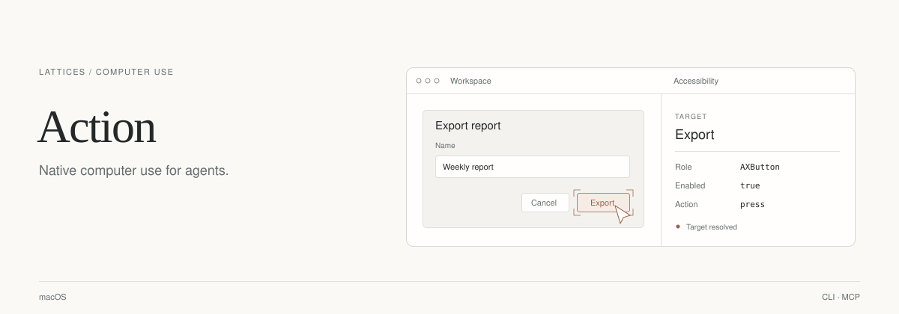

<p><a href="../../README.md">← Lattices</a> &nbsp; / &nbsp; Action</p>

<picture>
  <source media="(max-width: 600px) and (prefers-color-scheme: dark)" srcset="assets/readme/hero-mobile-dark.svg">
  <source media="(max-width: 600px) and (prefers-color-scheme: light)" srcset="assets/readme/hero-mobile-light.svg">
  <source media="(prefers-color-scheme: dark)" srcset="assets/readme/hero-dark.svg">
  <source media="(prefers-color-scheme: light)" srcset="assets/readme/hero-light.svg">
  
</picture>

<p align="center">
  <a href="https://lattices.dev/action">Product page ↗</a> &nbsp; · &nbsp;
  <a href="#install-and-run">Get started</a> &nbsp; · &nbsp;
  <a href="docs/getting-started.md">Documentation</a> &nbsp; · &nbsp;
  <a href="../../skills/action/SKILL.md">Agent skill</a>
</p>

Action gives agents a way to work with native Mac apps and browser surfaces. See what is on screen, find a target, take an action, and keep a recording of what happened.

<table><tr>
<td width="33%" valign="top"><strong>See the surface</strong><br>Combine screenshots, accessibility, and OCR to understand the current app.</td>
<td width="33%" valign="top"><strong>Take the next step</strong><br>Resolve a target, then click, type, scroll, or focus through a local runtime.</td>
<td width="33%" valign="top"><strong>Keep the evidence</strong><br>Save video, observations, and traces together for a run you can inspect.</td>
</tr></table>

## Install and run

Action is a separate macOS app. With Bun installed, install the Lattices CLI and
use its Action entry point:

```sh
bun add --global @lattices/lattices
lattices action install
lattices action launch
lattices action status --json
```

The installer downloads `Action.dmg` from the latest `action-v*` release and
installs `Action.app` in `/Applications`. It does not require a source checkout.
Grant Accessibility and Screen Recording permissions when prompted for native
control and capture.

To query the running Action agent:

```sh
lattices action call status
```

## CLI and MCP

The product CLI provides inspection and scenario commands. From
`products/action`, inspect the focused surface:

```sh
bun run action inspect current-surface
```

This captures a screenshot, accessibility snapshot, and Apple Vision OCR. The
inspection writes its observations, session record, manifest, and trace under
`artifacts/sessions/`. Provider-backed vision analysis is optional.

Start the native Action MCP server over stdio from `products/action`:

```sh
bun --cwd packages/mcp run start
```

Configure an MCP client to launch that command with the Action product directory
as its working directory. The default tool names include:

| Tool | Purpose |
| --- | --- |
| `health` | Check native host availability and permissions |
| `session_create` | Create a session directory |
| `observe_snapshot` | Capture screenshot, accessibility, and OCR artifacts |
| `resolve_target` | Resolve a runtime target query |
| `act_execute` | Click, type, press keys, drag, scroll, focus, or open an app |
| `record_start`, `record_status`, `record_stop` | Control and verify recording |
| `artifacts_list` | Read session artifacts |

The product-level `bun run mcp` script starts the same server through the local
`secret` helper and requires `MINIMAX_API_KEY`. Native capture and Apple Vision
OCR do not require that provider. Older docs use dotted tool names such as
`action.observe.snapshot`; the server advertises underscore names by default.

## At home in Lattices

Lattices core owns workspace organization and its daemon at
`ws://127.0.0.1:9399`. Action keeps its own app lifecycle and agent at
`ws://127.0.0.1:4319`.

- `lattices action` installs, launches, and queries Action. Other product CLI
  commands are forwarded when a `products/action` checkout is available.
- `lattices computer` calls the core daemon's `computer.*` workspace automation
  methods. Its API is documented in the [core API reference](../../docs/api.md).
- `lattices mcp` serves the Action Browser tools from the Lattices CLI. These
  tools drive Action-owned Chrome profiles through CDP. The native Action MCP
  server above controls macOS surfaces through the Action runtime.

For browser identity setup and the boundary between regular Chrome and
Action-owned profiles, see [Browser profiles](docs/browser-profiles.md) and the
[Lattices MCP documentation](../../docs/mcp.md).

## Architecture

`Action.app` owns AppKit, WebKit, permission UI, and recording probes. The local
agent handles transport and native requests. The TypeScript runtime owns
sessions, observations, targets, actions, and artifacts; CLI and MCP expose it
to operators and agents.

Recording runs in a fresh `Action.app` instance in `recording-probe` mode. A start
reply acknowledges startup. Use `record_status` to confirm completion and check
the video artifact; the `.finished` marker can also contain a recording error.

```text
native/engine/              Swift app host, agent, recording probe, build scripts
packages/protocol/          Session, observation, target, action, artifact types
packages/runtime/           Sessions, inspection, adapters, actions, persistence
packages/cli/               Product CLI and native development commands
packages/mcp/               Native Action MCP server
packages/companion/         Local job queue and observation store
crates/action-supervisor/   Companion process supervisor
packages/chrome-companion/  Chrome extension, bridge, profile tooling
packages/compiler/          Scenario compiler
packages/composer-core/     Render-manifest contract
packages/composer-remotion/ Remotion composition package
Installer/                 DMG packaging
docs/                      Runtime guides, API, architecture, design plans
```

<details>
<summary><strong>Build from source</strong></summary>

Requirements: macOS 14 or newer, Bun, and a Swift 6.2 toolchain. The build script
uses an available Apple Development or Developer ID Application signing identity;
without one, it uses ad hoc signing. Stable permission checks and
`native:verify` require a developer signing identity in Keychain.

From the Lattices repository root:

```sh
cd products/action
bun install
bun run native:app:build
bun run native:launch
```

The build produces `native/dist/Action.app`, including the Action agent helper.
The launch command builds again only if its source checks find a missing or
outdated app. Continue in `products/action` for the commands below.

After a native change:

```sh
bun run native:relaunch
```

Check the bundle, permission state, and TypeScript sources:

```sh
bun run native:verify
bun run native:permissions:status
bun run typecheck
```

With permissions granted, run the capture smoke checks:

```sh
bun run native:test:screenshot
bun run native:test:record
```

The recording check waits for completion and reports the video, finished marker,
and debug log. From the monorepo root, `bun run action:launch` and
`bun run action:dev` wrap the product's launch and relaunch commands.

</details>

## Further reading

- [Getting started](docs/getting-started.md): native development loop.
- [Native runtime](docs/native-runtime.md): app and agent ownership.
- [Recording](docs/recording.md): probe lifecycle and completion markers.
- [Agent API](docs/api.md): WebSocket protocol and native methods.
- [Browser profiles](docs/browser-profiles.md): Chrome identities and companion setup.
- [Architecture](docs/ARCHITECTURE.md): system design and longer-term direction.
- [Action on lattices.dev](https://lattices.dev/action): product overview and download.

---

<p align="center"><strong>Part of your Lattices workspace.</strong><br>
<a href="../../README.md">Lattices</a> · <a href="../action/README.md">Action</a> · <a href="../blink/README.md">Blink</a> · <a href="../voice/README.md">Speech / Voice</a><br>
<sub>Independent apps. A shared home.</sub></p>
