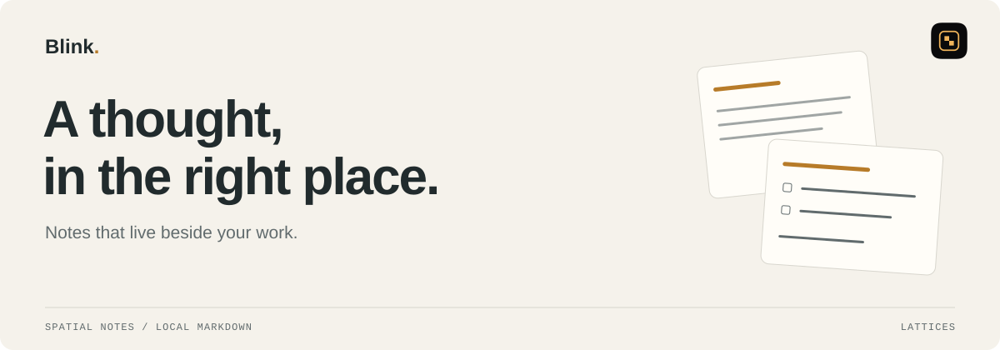

<p><a href="../../README.md">← Lattices</a> &nbsp; / &nbsp; Blink</p>

<picture>
  <source media="(max-width: 600px) and (prefers-color-scheme: dark)" srcset="assets/readme/hero-mobile-dark.svg">
  <source media="(max-width: 600px) and (prefers-color-scheme: light)" srcset="assets/readme/hero-mobile-light.svg">
  <source media="(prefers-color-scheme: dark)" srcset="assets/readme/hero-dark.svg">
  <source media="(prefers-color-scheme: light)" srcset="assets/readme/hero-light.svg">
  
</picture>

<p align="center">
  <a href="https://lattices.dev/blink">Product page ↗</a> &nbsp; · &nbsp;
  <a href="#install-and-run">Get started</a> &nbsp; · &nbsp;
  <a href="docs/cli.md">Documentation</a> &nbsp; · &nbsp;
  <a href="../../skills/blink/SKILL.md">Agent skill</a>
</p>

Keep a thought beside the work it belongs to. Blink turns local Markdown into floating native notes, with a remembered place on your desktop and a CLI your agents can use too.

<table><tr>
<td width="33%" valign="top"><strong>Capture a thought</strong><br>Open a note from the menu bar, command palette, or a global hotkey.</td>
<td width="33%" valign="top"><strong>Give it a place</strong><br>Arrange floating panels beside your work. Return to the same position and size.</td>
<td width="33%" valign="top"><strong>Share the context</strong><br>You and your agents read and edit the same local Markdown files.</td>
</tr></table>

## Install and run

The packaged app and CLI require macOS 14+ on Apple Silicon. Install the package
with Bun; its command launchers require Node.js 18+.

```sh
bun add --global @arach/blink
blink app install
blink app open
```

The package includes the native `blink` CLI. `blink app install` downloads and
validates a Blink release, then installs `Blink.app` in `/Applications`.
`blink app open` launches the installed app. To update it, run `blink app update`.
You can also get the app from the [download page](https://lattices.dev/blink/download).

Blink runs from the menu bar without a Dock icon. Press Hyper+N to create a note;
Hyper means Control+Option+Shift+Command. The default Hyper+B shortcut shows or
hides the note panels. Hotkeys are configurable in [config.json](docs/config.md).

## Notes and panels

The CLI can create and edit notes while the app is closed. Live panel commands
need Blink running with the same data directory.

```sh
blink present readme-review "# README review" --slot 6 --writer agent
blink desk open readme-review
blink type readme-review "Check the build commands." --writer agent
blink cat readme-review
blink ls --json
```

`present` creates or updates a note's content and presentation. `type` appends text
with a typed reveal in an open panel; `write` replaces the body without that
animation. `desk open` opens or focuses the note's single panel. See the
[CLI reference](docs/cli.md) for search, placement, JSON output, and other commands.

Notes live in `~/Library/Application Support/Blink/Notes/`, one Markdown file per
note with YAML frontmatter. Writes are atomic, and Blink preserves frontmatter
keys it does not own. The app watches this directory and reconciles external
changes through `NoteStore`.

The same application-support directory holds `config.json` for behavior and
appearance, and `edits.sqlite` for the append-only edit ledger. Markdown remains
the source of truth for note contents. Configuration changes apply while the app
is running. Per-device panel frames and the open-panel set live in `UserDefaults`.

Set `BLINK_HOME` to override the file-backed data directory for tests or agent
work. It does not redirect `UserDefaults`, and the app disables mobile sharing
when the override is set.

Use [workspaces](docs/workspaces.md) to group notes and give them shared visual
settings. Named desk arrangements save and restore the open panels:

```sh
blink desk save review
blink desk ls --json
blink desk restore review
```

## Relationship to Lattices

Lattices manages the desktop workspace; Blink owns its note panels and data.
Blink is a separate app with its own signing, lifecycle, CLI, and store. It shares
the monorepo, website, and [agent skill catalog](../../skills/blink/SKILL.md)
with Lattices core.

Use `blink` for note operations. This checkout does not expose Blink through a
Lattices CLI subcommand or MCP server. Its live app interface includes a local
Unix socket at `~/Library/Application Support/Blink/blink.sock`, used by desk
save and restore; it is separate from the [Lattices daemon](../../docs/api.md).
The product's agent API and MCP design documents describe proposals.

## Architecture

Native Swift/AppKit panels host the CodeMirror 6 editor in `WKWebView`.
`NoteStore` owns note mutations; `PanelManager` owns panel identity, geometry,
and save flushing. The CLI uses the same BlinkCore file storage as the app.

```text
Sources/BlinkApp/    Menu bar, panels, palette, editor bridge, local socket
Sources/BlinkCore/   Notes, frontmatter, storage, workspaces, desk layouts
Sources/BlinkCLI/    Native notes and panel commands
Sources/BlinkPeer/   Encrypted local-network pairing and snapshot transport
web/editor/         CodeMirror editor and its bundle build
apps/ios/           Read-only iPhone and iPad companion
Tests/              Core and peer protocol tests
packages/npm/       Published CLI wrapper and app installer
scripts/            Local app bundling and launch
tools/release/      CLI and DMG packaging, signing, and release tooling
docs/               CLI, configuration, workspaces, sync, and release docs
```

<details>
<summary><strong>Build from source</strong></summary>

Use macOS 14+, a Swift 6 toolchain, Bun, and Node.js 18+. The editor build script
runs with Node. SwiftPM resolves a pinned revision of the Hudson repository
over SSH, so the build needs Git access to that repository.

From the Lattices repository root:

```sh
cd products/blink
(cd web/editor && bun install && bun run build)
./scripts/run-app.sh --debug --restart
```

The launch script builds `BlinkApp`, bundles the editor into `dist/Blink.app`, and
launches that bundle. `--restart` stops an existing process from the same bundle
path. Build the editor first: the native script does not build it for you.

To build and inspect the notes CLI from the product directory:

```sh
swift build --product blink
.build/debug/blink ls --json
```

Use `.build/debug/blink` in place of `blink` in the note examples below. The
`blink app` installer belongs to the packaged command wrapper, not the Swift
executable.

The repository root also provides build and test scripts:

```sh
bun run blink:build
bun run blink:check
```

These run the product's Swift build and tests. For local Hudson development,
set `BLINK_HUDSON_SOURCE=path` and optionally `BLINK_HUDSON_PATH`; its default
is `../../../hudson`, relative to this product. See [Package.swift](Package.swift)
for dependency selection and [release documentation](docs/release.md) for packaging.

</details>

## Documentation

- [CLI](docs/cli.md): note operations, live panels, and structured output.
- [Configuration](docs/config.md): hotkeys, behavior, panel appearance, and editor theme.
- [Workspaces](docs/workspaces.md): note groups and shared visual settings.
- [iOS companion](docs/ios-sync.md): pairing, offline snapshots, and build instructions.
- [Releases](docs/release.md): build artifacts, signing, and distribution.
- [Product page](https://lattices.dev/blink): overview and downloads.

---

<p align="center"><strong>Part of your Lattices workspace.</strong><br>
<a href="../../README.md">Lattices</a> · <a href="../action/README.md">Action</a> · <a href="../blink/README.md">Blink</a> · <a href="../voice/README.md">Speech / Voice</a><br>
<sub>Independent apps. A shared home.</sub></p>
